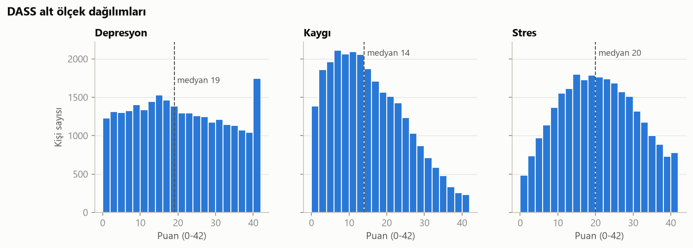
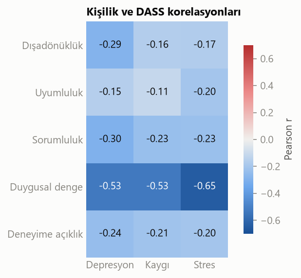
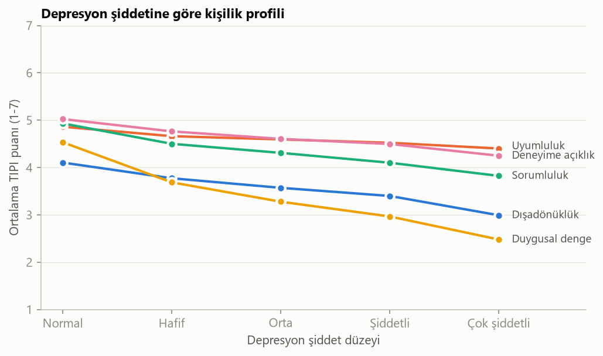
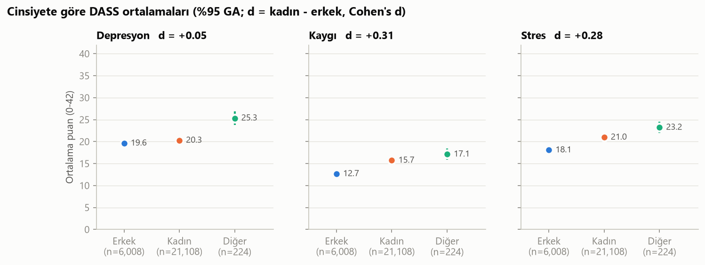
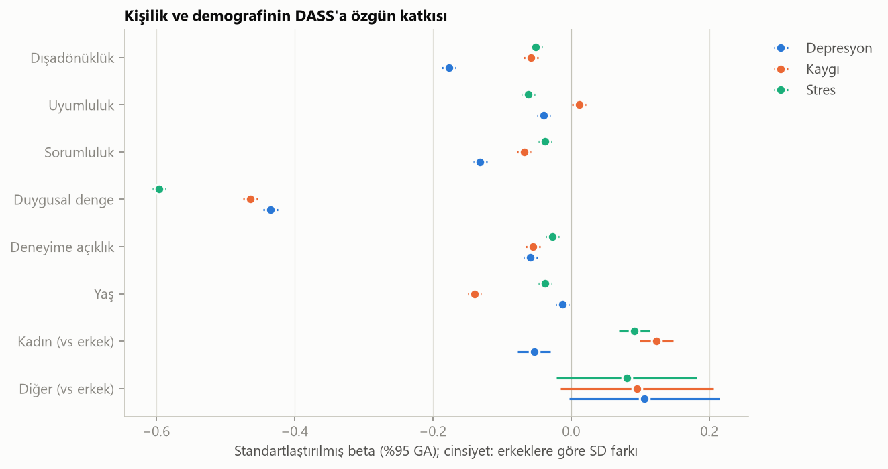
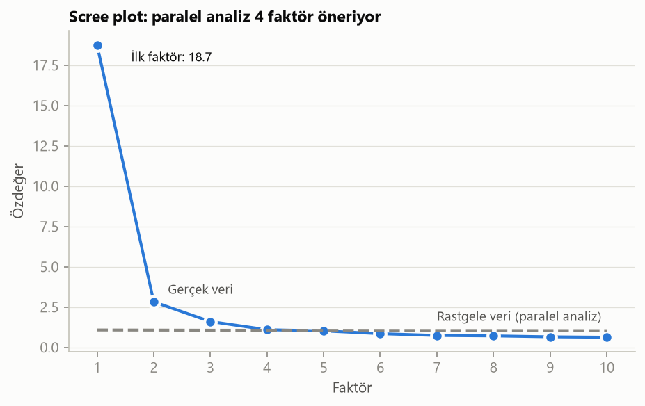
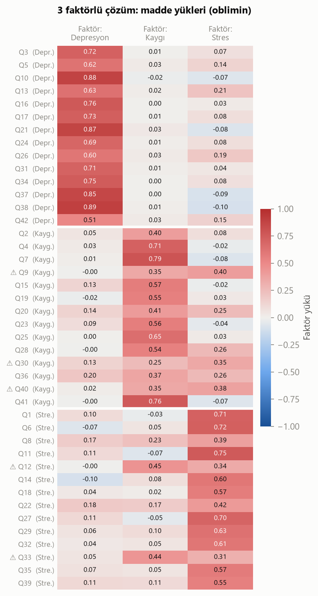

# dass-personality

**Kişilik özellikleri, depresyon, kaygı ve stresle ne kadar ilişkili?**

Open Psychometrics'in herkese açık DASS verisiyle (~39 bin katılımcı) Big Five kişilik
özelliklerinin (TIPI) depresyon, kaygı ve stres (DASS-42) puanlarıyla ilişkisini inceleyen
küçük bir veri bilimi projesi.

## Özet

- **Kişilik, DASS puanlarındaki farklılığın %32–43'ünü açıklıyor**; yaş ve cinsiyet tek başına %1–6.
- En güçlü ilişki **duygusal denge** ile (r = −0,53 ile −0,65). Ancak bu kısmen döngüsel:
  TIPI'nin ilgili maddesi zaten "kaygılı, kolay üzülen" diye soruyor. Bu özellik çıkarıldığında
  bile kişilik depresyonun %19'unu açıklıyor.
- **Depresyon** özellikle düşük **dışadönüklük** ve düşük **sorumlulukla** ilişkili; kaygı ve streste bu iki özelliğin rolü çok daha küçük.
- **Cinsiyet farkları küçük:** kadınlar kaygı (d = 0,31) ve streste (d = 0,28) biraz daha yüksek,
  depresyonda fark yok (d = 0,05). Kişilik kontrol edildiğinde bu farklar daha da küçülüyor.
- **DASS'ın 3 alt ölçeği ayırt edilebiliyor ama güçlü bir "genel sıkıntı" faktörü baskın:**
  toplam puanın %82'si tek bir genel faktörce belirleniyor (omega hiyerarşik = 0,82).
  Kaygı alt ölçeği bu genel faktörle neredeyse aynı (yük = 0,91).

## Veri

[Open Psychometrics](https://openpsychometrics.org/_rawdata/) — DASS çevrimiçi test verisi, 2017–2019.
Katılımcılar testi kişisel sonuç almak için gönüllü olarak doldurmuş ve verilerinin araştırmada
kullanılmasını onaylamış.

- **DASS-42:** 42 madde, 3 alt ölçek (depresyon, kaygı, stres), her biri 0–42 puan
- **TIPI:** 10 maddelik Big Five kişilik envanteri, her özellik 1–7
- **VCL:** kelime bilgisi kontrol listesi; 3'ü uydurma kelime (geçerlilik kontrolü)

Ham veri repoya dahil değil; `src/download_data.py` ile indirilir.

## Yöntem

### 1. Temizlik (`src/clean.py`)

| Filtre | Kalan | Elenen |
|---|---:|---:|
| Başlangıç | 39.775 | |
| TIPI yanıtı eksik değil | 38.341 | 1.434 |
| Uydurma kelime işaretlememiş | 33.276 | 5.065 |
| Yaş 18–80 | 27.419 | 5.857 |
| Test süresi ≥ 60 sn | **27.378** | 41 |

Uydurma kelimeleri (*cuivocal, florted, verdid*) "biliyorum" diye işaretleyenler dikkatsiz ya da
abartılı yanıt verme eğiliminde kabul edilip çıkarıldı. DASS yetişkinler için geliştirildiğinden
18 yaş altı dışarıda bırakıldı.

### 2. Skorlama (`src/score.py`)

- DASS: orijinal 0–3 ölçeğine çevrilip alt ölçek başına 14 madde toplandı; resmi kesme puanlarıyla şiddet düzeyi atandı.
- TIPI: ters maddeler `8 − yanıt` ile çevrilip her özellik için iki maddenin ortalaması alındı.
- Güvenilirlik (Cronbach alfa): depresyon 0,955, kaygı 0,911, stres 0,928.

### 3. Keşif (`src/explore.py`) ve model (`src/model.py`)

- Pearson korelasyonları, şiddet düzeyine göre kişilik profilleri
- Cinsiyet karşılaştırmasında p-değeri yerine etki büyüklüğü (Cohen's d); n = 27 bin iken en küçük fark bile "anlamlı" çıkar
- Doğrusal regresyon: R² 5 katlı çapraz doğrulamayla, katsayılar standartlaştırılmış beta olarak

### 4. Faktör analizi (`src/factor.py`)

- Uygunluk: KMO ve Bartlett testleri
- Faktör sayısı: scree plot ve paralel analiz (rastgele veriyle karşılaştırma)
- Açımlayıcı faktör analizi: 3 faktör, minres, eğik (oblimin) rotasyon
- Bifaktör yapısı: Schmid-Leiman dönüşümü, omega hiyerarşik ve ECV

## Bulgular

### Dağılımlar



Örneklemin %31'i "çok şiddetli" depresyon aralığında. Bu genel nüfus hakkında bir şey söylemiyor:
çevrimiçi depresyon testi arayan insanlar zaten kendini kötü hisseden insanlar olmaya yatkın
(seçilim yanlılığı). Depresyonda ölçeğin tavanında (42) belirgin bir yığılma var.

### Kişilik ve DASS korelasyonları



### Depresyon şiddetine göre kişilik profili



"Normal"den "çok şiddetli"ye duygusal denge 4,5'ten 2,5'e düşüyor; dışadönüklük ve sorumluluk da
belirgin biçimde azalıyor, uyumluluk neredeyse sabit.

### Cinsiyet



| | d (kadın − erkek) | Yorum |
|---|---:|---|
| Depresyon | +0,05 | fark yok |
| Kaygı | +0,31 | küçük |
| Stres | +0,28 | küçük |
| Duygusal denge | −0,33 | küçük |

"Diğer" grubu (n = 224) üç ölçekte de en yüksek ortalamaya sahip, ancak grup küçük ve güven aralıkları geniş.

### Regresyon

| Çapraz doğrulamalı R² | Sadece demografi | Kişilik + demografi | Duygusal denge hariç |
|---|---:|---:|---:|
| Depresyon | 0,009 | **0,339** | 0,185 |
| Kaygı | 0,057 | **0,316** | 0,141 |
| Stres | 0,026 | **0,427** | 0,138 |



### DASS gerçekten 3 ayrı boyut mu?

Üç alt ölçek birbiriyle r = 0,67–0,80 korelasyonlu. Bu yüzden ölçeğin aslında tek bir
"genel sıkıntı" boyutunu mu ölçtüğü faktör analiziyle test edildi.

**Veri uygun:** KMO = 0,985 ("mükemmel"), Bartlett testi p < 0,001.



İlk faktörün özdeğeri 18,7: tek başına 42 maddedeki toplam varyansın %45'ini açıklıyor. İkinci ve
üçüncü faktörler (2,8 ve 1,6) açıkça rastgele verinin üzerinde. Paralel analiz 4 faktör
öneriyor ama dördüncü faktör rastgele düzeyin ancak hemen üzerinde (1,09'a karşı 1,08); bu
büyüklükte bir örneklemde anlamlı bir boyut sayılmaz. Teorideki 3 faktörlü yapıyla devam edildi.



**3 faktörlü çözüm teoriyle büyük ölçüde uyumlu:** 42 maddenin 37'si en yüksek yükünü kendi
alt ölçeğinin faktörüne veriyor. Depresyon en net ayrışan alt ölçek (14/14 madde, yükler 0,51–0,89).
Uyumsuz 5 madde (⚠) hep kaygı ile stres arasında gidip geliyor:

- Kaygı maddeleri Q9 ("rahatladığım durumlar"), Q30 ("sıradan bir işten korkmak") ve Q40
  ("panikleyip rezil olmaktan endişe") daha çok **stres** faktörüne yükleniyor. Bunlar bedensel
  değil, **durumsal/bilişsel** kaygı maddeleri.
- Stres maddeleri Q12 ("sinirsel enerji harcamak") ve Q33 ("sinirsel gerginlik") daha çok
  **kaygı** faktörüne yükleniyor; ikisi de bedensel uyarılmışlığa yakın ifadeler.

Yani veride kaygı faktörü "bedensel alarm" olarak, stres faktörü ise "gerginlik ve endişe"
olarak ayrışıyor; sınırdaki maddeler ifadelerine göre taraf seçiyor.

**Bifaktör (Schmid-Leiman) sonuçları:**

| Gösterge | Değer | Anlamı |
|---|---:|---|
| Genel faktör yükü: depresyon / kaygı / stres | 0,78 / **0,91** / 0,74 | Kaygı neredeyse tamamen genel faktör |
| Omega toplam | 0,974 | Toplam puan çok güvenilir |
| Omega hiyerarşik | **0,817** | Toplam puan varyansının %82'si tek bir genel faktörden geliyor |
| ECV | 0,706 | Ortak varyansın %71'i genel faktöre, %29'u alt ölçeklere ait |

**Sonuç:** DASS'ın üç alt ölçeği istatistiksel olarak ayırt edilebiliyor, ama hepsinin altında
güçlü bir ortak "olumsuz duygulanım" faktörü yatıyor; bu da üçlü modelin "ortak çekirdek"
öngörüsüyle uyumlu. Pratik anlamı: Bu projedeki cinsiyet ve kişilik bulgularının önemli bir kısmı
üç ayrı bulgu değil, aynı genel sıkıntının üç görünümü olarak okunmalı. Alt ölçeklere özgü
yorumlar en çok **depresyon** için güvenilir.

## Sınırlılıklar

- **Seçilim yanlılığı:** Gönüllü, çevrimiçi ve kendi isteğiyle depresyon testi arayan bir örneklem. Yaygınlık tahmini için kullanılamaz.
- **Örneklem kompozisyonu:** %77 kadın, %63 Malezya, yaş medyanı 22 (temizlenmiş veride). Sonuçlar başka gruplara genellenmeyebilir.
- **Döngüsellik:** TIPI duygusal denge maddesi ile DASS içerik olarak örtüşüyor.
- **Kısa ölçek:** TIPI her özelliği 2 maddeyle ölçüyor; ölçüm hatası korelasyonları olduğundan düşük gösterebilir.
- **Tavan etkisi:** DASS en uç puanlarda ayırt edicilik kaybediyor.
- **Nedensellik yok:** Kesitsel veri. Kişilik depresyonu etkiliyor olabilir, depresyon da kişinin kendini algılayışını.
- **Pearson korelasyonu:** 4 basamaklı maddeler için ideal olan polikorik korelasyondur; faktör yükleri bir miktar düşük tahmin edilmiş olabilir.
- Bu bir tanı aracı değildir.

## Çalıştırma

```bash
py -m venv .venv
.venv\Scripts\activate
pip install -r requirements.txt

python src/download_data.py   # ham veriyi indirir -> data/raw/
python src/clean.py           # -> data/processed/clean.csv
python src/score.py           # -> data/processed/scored.csv
python src/explore.py         # -> figures/01-04
python src/model.py           # -> figures/05
python src/factor.py          # -> figures/06-07
```

## Kaynaklar

- Lovibond, S. H., & Lovibond, P. F. (1995). *Manual for the Depression Anxiety Stress Scales.* Psychology Foundation.
- Clark, L. A., & Watson, D. (1991). Tripartite model of anxiety and depression. *Journal of Abnormal Psychology, 100*(3), 316–336.
- Gosling, S. D., Rentfrow, P. J., & Swann, W. B., Jr. (2003). A very brief measure of the Big-Five personality domains. *Journal of Research in Personality, 37*, 504–528.
